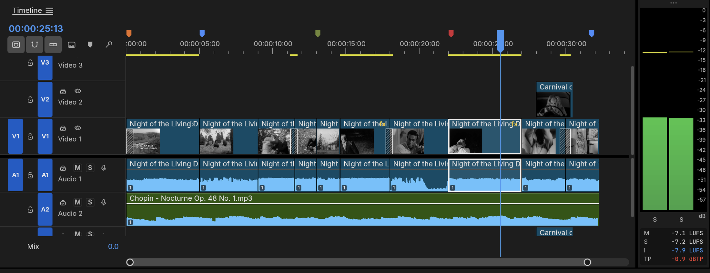
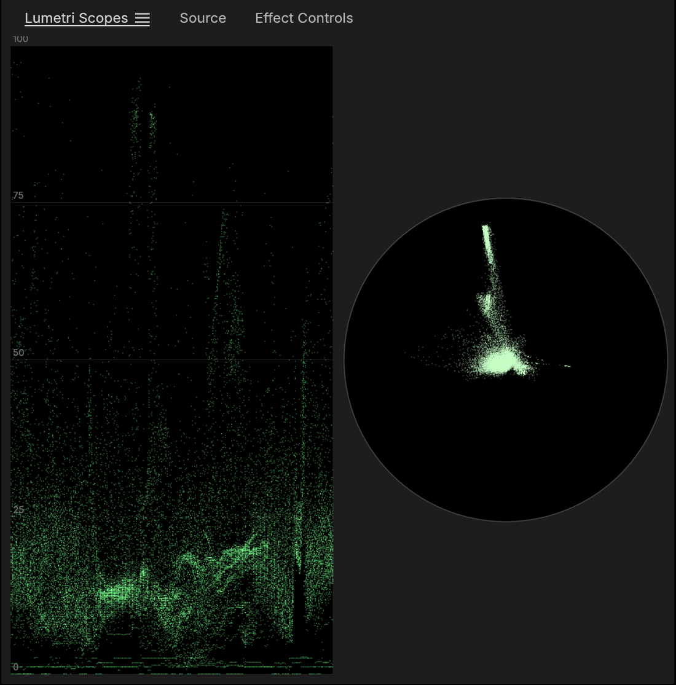
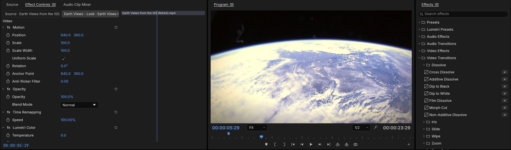

<p align="center">
  <a href="https://getartcraft.com/">
    <picture>
      <source media="(prefers-color-scheme: dark)" srcset="docs/brand/artcraft-logo-white.svg">
      
    </picture>
  </a>
</p>


<h1 align="center">FilmCraft</h1>

<p align="center">
  <b>Монтаж видео, цвет и звук; открытая (clean-room) реализация Adobe Premiere Pro на чистом Rust.</b>
</p>

<p align="center">
  Открытый взгляд с чистого листа на рабочий процесс Adobe Premiere Pro: нативно на macOS, Windows и Linux, а также в браузере через WebAssembly.<br>
  От команды ArtCraft.
</p>

<p align="center">
  <a href="#лицензия-и-авторские-права"></a>
  
  
  <a href="#статус"></a>
</p>

<p align="center">
  <a href="https://discord.gg/artcraft"></a>
</p>

<p align="center">
  <a href="https://getartcraft.com/apps/filmcraft"><b>FilmCraft на getartcraft.com</b></a> ·
  <a href="https://getartcraft.com/">ArtCraft</a> ·
  <a href="https://getartcraft.com/apps">Все приложения Crafting</a>
</p>

<br>

<p align="center">
  
</p>

<p align="center"><sub><i>Apollo 11 - Tranquility</i>: трехминутный документальный монтаж материалов НАСА 1969 года о запуске, посадке и высадке на Луну с субтитрами из стенограммы миссии. Каждый кадр на этих скриншотах получен из материалов в общественном достоянии, декодирован, скомпонован и обработан собственным кодом FilmCraft.</sub></p>

> [!NOTE]
> **ArtCraft — это сообщество художников и творцов из всех сфер.** Цифровое искусство, генеративная графика, музыка,
> игры &mdash; если вы создаете вещи, вы один из нас. **[Заходите поздороваться в Discord](https://discord.gg/artcraft).**

<p align="center">
  <a href="#монтаж">Монтаж</a> ·
  <a href="#цвет">Цвет</a> ·
  <a href="#эффекты-и-анимация">Эффекты</a> ·
  <a href="#звук">Звук</a> ·
  <a href="#титры-и-субтитры">Титры</a> ·
  <a href="#форматы-и-кодеки">Форматы</a> ·
  <a href="#экспорт">Экспорт</a> ·
  <a href="#обмен-данными">Обмен данными</a> ·
  <a href="#создан-для-ии-агентов">Агенты</a> ·
  <a href="#начало-работы">Начало работы</a> ·
  <a href="#скачать">Скачать</a> ·
  <a href="#документация">Документация</a> ·
  <a href="#статус">Статус</a>
</p>

<br>

FilmCraft — это нелинейный видеоредактор для тех, кто знает Premiere: те же панели, рабочие пространства, инструменты и горячие клавиши, так что ваши руки уже знают, где что находится. Внутри же он полностью нов от битового потока до интерфейса. Кодеки H.264, HEVC, ProRes и AAC — наши собственные, написанные на Rust по открытым спецификациям. GPU-композитор работает в линейном свете. Вычисления кадров производятся по точному целочисленному времени, поэтому монтажные склейки никогда не сдвигаются. А каждое действие в приложении — это команда, которую ИИ-агент может выполнять так же точно, как и вы.

<br>

## Монтаж

<p align="center">
  
</p>

<p align="center"><sub>Рабочее пространство Сборка (Assembly), монтаж трейлера к фильму <i>Ночь живых мертвецов</i> (1968) со вставкой из фильма <i>Карнавал душ</i> (1962).</sub></p>

**Знакомый таймлайн.** Мониторы Источника (Source) и Программы (Program), бины с миниатюрами, многодорожечный таймлайн с кнопками назначения и патчинга дорожек, блокировкой синхронизации и связанным выделением. Рабочие пространства Монтаж (Editing), Сборка (Assembly), Цвет (Color), Эффекты (Effects) и Звук (Audio) на месте, а любую панель можно закрепить там, где вам удобно.

- **Трехточечный монтаж.** Отметьте точки Входа (In) и Выхода (Out) в мониторе Источника, затем вставьте (`,`) или перезапишите (`.`) на назначенные дорожки. Извлечение (Lift `;`) и удаление со сдвигом (Extract `'`) вырезают диапазоны обратно.
- **Все виды подрезки.** Инструменты подрезки со сдвигом (Ripple), совмещенной подрезки (Roll), прокрутки (Slip), скольжения (Slide), растяжения времени (Rate Stretch) и лезвия (Razor). Режим подрезки выбирает точки склейки как ripple, roll или trim, сдвигает их поочередно на кадр (`⌥←` `⌥→`, ×5 с `⇧`), переключает тип подрезки с помощью `⌃T` и продлевает их до курсора воспроизведения с помощью `E`. Горячие клавиши `Q` и `W` выполняют подрезку со сдвигом до курсора. **Монитор подрезки (Trim Monitor)** показывает обе стороны склейки, а **динамическая подрезка** подрезает в реальном времени во время воспроизведения: `L` вперед, `J` назад, `K` для остановки и сохранения как один шаг отмены.
- **Точное время.** Каждый монтажный стык рассчитывается в целочисленных тиках: 254 016 000 000 в секунду, что нацело делится на любую распространенную частоту кадров и дискретизацию звука. Частоты 23.976, 29.97 drop-frame и 59.94 считаются абсолютно точно, без округлений.
- **Детали, на которые полагаются профессионалы.** Маркеры с цветами, названиями и длительностью; экспорт заметок к последовательности через **Маркеры ▸ Экспортировать маркеры как CSV…**; добавление склейки (`⌘K`) на одной или всех дорожках; вложенные последовательности (Nesting); копирование, вставка и вставка со сдвигом; удаление со сдвигом и закрытие разрывов; привязка (Snapping); неограниченная отмена действий с панелью Истории (History).
- **Ваши горячие клавиши.** Редактор горячих клавиш (`⌥⌘K`) с визуальной клавиатурой, сочетаниями для конкретных панелей, предупреждениями о конфликтах и пресетами раскладок для FilmCraft, Premiere Pro, Final Cut Pro и Avid.
- **Никогда не потеряете работу.** Сохранения выполняются атомарно, автосохранение поддерживает скользящий набор версий, а журнал восстановления после сбоев, записываемый примерно через секунду после каждого изменения, восстанавливает несохраненные правки после падения программы или отключения питания.

<p align="center">
  
</p>

<p align="center"><sub>Крупный план: переходы растворения, вставка на V2, музыкальная дорожка на A2, цветные маркеры и измерители громкости справа.</sub></p>

<br>

## Цвет

<p align="center">
  
</p>

<p align="center"><sub>Рабочее пространство Цвет (Color) на фильме <i>Шарада</i> (1963) с интерактивными скопами рядом с монитором Программы.</sub></p>

**Полная панель цветокоррекции в стиле Lumetri**, в порядке работы колориста:

- **Базовая коррекция (Basic Correction):** температура и оттенок, экспозиция, контраст, светлые участки, тени, белые, черные, насыщенность.
- **Креативный (Creative):** восемь встроенных луков (looks) с регулятором интенсивности, а также выцветшая пленка (faded film), резкость и сочность (vibrance). Луки — это цветовые преобразования, написанные в коде, а не файлы LUT.
- **Кривые (Curves):** редактор кривых RGB с монотонно-кубической интерполяцией (без выбросов), а также цветовой тон / насыщенность, тон / тон, тон / яркость, яркость / насыщенность и насыщенность / насыщенность.
- **Цветовые колеса (Color Wheels):** колеса теней, средних тонов и светлых участков, каждое со своим регулятором яркости.
- **Вторичный HSL (HSL Secondary):** изоляция цвета по тону, насыщенности и яркости, просмотр маски ключа и коррекция только выделенного участка.
- **Виньетка (Vignette):** величина, средняя точка, округлость и растушевка.

<table>
  <tr>
    <td width="34%" valign="top" align="center">
      <br>
      <sub><b>Панель Lumetri Color.</b> Базовая коррекция, цветовые колеса и каждый другой раздел имеют свой переключатель вкл/выкл.</sub>
    </td>
    <td width="66%" valign="top" align="center">
      <br>
      <sub><b>Точные измерители (Scopes).</b> Осциллограмма и вектороскоп рассчитываются по обработанному кадру. Вся цветокоррекция происходит в линейном свете с 32-битной плавающей запятой.</sub>
    </td>
  </tr>
</table>

<br>

## Эффекты и анимация

<p align="center">
  
</p>

<p align="center"><sub>Вид Земли с МКС от НАСА с примененным стилем и открытым браузером эффектов на переходах растворения.</sub></p>

- **Полный бин видеоэффектов Premiere 26 (93 эффекта в 16 папках), бин устаревших эффектов (Legacy) и эффектов из старых проектов, плюс около 30 переходов.** Размытия (Bokeh, Focus, Compound), кеинг (Ultra Key, Track Matte), искажения (Corner Pin, Turbulent Displace, Warp Stabilizer), источники света и свечение (Lights & Glows), эффекты иммерсивного видео (VR) для эквидистантного видео, Posterize Time, Echo и другие. Перекрестные переходы (Cross dissolve), уход в черное или белое, пленочное растворение, шторки, диафрагмы, вытеснения, сдвиги, зум, отгиб страницы, вращение куба и многое другое.
- **Движение и непрозрачность на каждом клипе:** положение, масштаб, поворот, опорная точка (anchor point) и подавление мерцания (anti-flicker), а также 26 режимов наложения.
- **Ключевые кадры как в Premiere:** линейные, Безье, авто-Безье и непрерывные Безье, удержание (hold), плавный вход (ease in) и плавный выход (ease out). Панель Element Controls (Управление эффектами) показывает дорожку ключевых кадров для каждого параметра под временной линейкой, а каждый анимированный параметр раскрывается в **графики значений и скорости** с перетаскиваемыми манипуляторами влияния. Элементы управления эффектами и панель Свойств (Properties) используют общий навигатор ключевых кадров (◀ ◆ ▶): добавление или удаление ключевого кадра в позиции курсора, переход к предыдущему или следующему.
- **GPU-композитор** на базе wgpu (Metal, Vulkan, DirectX 12, WebGPU). Он делает выборку YUV напрямую из декодера с суперсэмплингом и смешивает в линейном свете. Программный CPU-рендер рендерит те же кадры, и оба пути тестируются друг относительно друга.

<p align="center">
  
</p>

<p align="center"><sub>Плавное приближение на титульном кадре: график значений, график скорости и манипулятор влияния Безье.</sub></p>

<br>

## Звук

- **Измерители громкости по вещательным стандартам.** Моментальная, краткосрочная и интегрированная громкость, а также истинный пик (true peak) по стандартам ITU-R BS.1770 и EBU R128 наряду с пиковыми измерителями. Наше интегрированное значение совпадает с фильтром `ebur128` из ffmpeg с точностью до десятой доли LU.
- **Эффекты клипов на нашей собственной библиотеке DSP:** параметрический эквалайзер, фильтры верхних, нижних и полосовых частот, динамическая обработка, лимитер истинных пиков, дилей, реверберация, DeNoise, DeHummer, инверсия и сдвиг тона (pitch shift). Параметры можно анимировать ключевыми кадрами. Эффекты остаются непрерывными при скраббинге, воспроизведении и экспорте с компенсацией задержки.
- **Микшер аудиодорожек (Audio Track Mixer) и Микшер аудиоклипов (Audio Clip Mixer):** фейдеры, панорама, глушение (mute), соло, пять слотов вставки на дорожку (pre- или post-fader), посылы, субмиксы и мастер-трек Mix, все с точностью до сэмпла и компенсацией задержки. 24 дорожки с тремя эффектами на каждой микшируются примерно в 6 раз быстрее реального времени на одном ядре.
- **Автоматизация как на консоли:** режимы Чтение (Read), Фиксация (Latch), Касание (Touch) и Запись (Write), записываемые вживую с микшера во время воспроизведения, отображаются и редактируются как ключевые кадры дорожки на таймлайне. Плюс диалог Громкости аудио (Audio Gain — задать, изменить, нормализовать) и кроссфейды с постоянной мощностью (constant-power).
- **Воспроизведение по аудиочасам.** Звуковая карта является мастер-часами, поэтому видео подстраивается под звук, а не наоборот.

<br>

## Титры и субтитры

- **Настоящий текстовый движок:** шейпинг OpenType с кернингом и лигатурами, двунаправленный текст (BiDi), переносы строк, трекинг и интерлиньяж, отрисовка в линейном свете с четкостью на любом масштабе и при любом повороте.
- **Инструменты Текст (Type), Фигура (Shape) и Перо (Pen)** на мониторе Программы: нажмите, чтобы ввести текст, редактируйте курсором и выделением, рисуйте прямоугольники, эллипсы и контуры. Графические клипы содержат текстовые и фигурные слои с заливкой, обводкой, фоном и тенью — все с поддержкой ключевых кадров и редактированием на панели Свойств (Properties).
- **Субтитры:** дорожки субтитров в форматах Subtitle, CEA-608, CEA-708 и Teletext; импорт и экспорт SRT, WebVTT и SCC с точностью до кадра; редактирование субтитров на панели Текста (Text) и вшивание их при экспорте.
<br>

## Форматы и кодеки

Внутри нет FFmpeg. Видеокодеки, AAC, Opus и контейнеры — это наш собственный код на Rust, реализованный по открытым спецификациям ITU-T, ISO и IETF и протестированный по кадрам относительно ffmpeg как внешнего эталона.

| | Декодирование | Кодирование | Примечания |
|---|:---:|:---:|---|
| **H.264 / AVC** | ✓ | ✓ | Декодер битово-точен на 37+ потоках, 500–600 кадров/с в 1080p. Энкодер: профили High, Main и Baseline, CABAC, B-кадры, CRF/CBR/VBR/2-pass |
| **HEVC / H.265** | ✓ | | Main и Main 10, битово-точен на 41 потоке (тайлы, WPP, PCM, долгосрочные ссылки), около 225 кадров/с в 1080p |
| **Apple ProRes** | ✓ | ✓ | Декодирует 422 Proxy до 4444 XQ; экспорт пишет 422 HQ |
| **AAC-LC** | ✓ | ✓ | |
| **VP8** | ✓ | | Все инструменты кодирования, версии битового потока 0–3, скрытые кадры altref, альфа-слой прозрачного WebM; битово-точен с libvpx на официальных тестах VP8; в WebM/Matroska и MP4 |
| **VP9** | ✓ | | Профили 0–3, 8/10/12 бит, 4:2:0 до 4:4:4, тайлы и суперкадры; битово-точен на 50+ потоках; в WebM/Matroska и MP4 |
| **Opus** | ✓ | | SILK, CELT, гибридный и многопоточный объемный звук; точен по диапазонам на всех тестах соответствия RFC 8251; в WebM/Matroska и MP4 |
| **AV1** | ✓ | | Профиль Main, 8/10-бит 4:2:0 и монохром, все инструменты кодирования включая зернистость пленки, superres и пространственные слои; битово-точен с libdav1d; в MP4 и WebM/Matroska |
| **Avid DNxHD / DNxHR** | ✓ | ✓ | Все CID стандарта SMPTE ST 2019-1 (от LB до 444, 8/10/12-бит); экспорт пишет DNxHR в MOV |
| **MJPEG, PCM** | ✓ | ✓ | |
| **MP3, FLAC, ALAC, Vorbis** | ✓ | | Через библиотеку [symphonia](https://github.com/pdeljanov/Symphonia) (MPL-2.0) временно, готовится замена на собственный код |
| **MP4 / MOV** | ✓ | ✓ | Фрагментированный MP4, списки монтажа (edit lists), дорожки таймкода |
| **Matroska / WebM** | ✓ | | Lacing, Cues, удаление заголовков, метаданные цвета HDR |
| **AVI** | ✓ | | AVI 1.0 и OpenDML (файлы больше 1 ГБ); Motion JPEG, H.264, HEVC и несжатый RGB / YUV с PCM, MP3, MP2 или AC-3. DivX / Xvid и DV пока в разработке |
| **Изображения** | ✓ | ✓ | Импорт PNG, JPEG, GIF, WebP, TIFF и BMP (анимированные GIF и APNG как клипы, с прозрачностью); экспорт последовательностей PNG и анимированных GIF |

Также поддерживается импорт: MPEG-2 / MPEG-1 видео, AC-3, MP2, MXF (OP1a / OP-Atom), транспортные и программные потоки MPEG (AVCHD, вещательные, DVD), Ogg и последовательности изображений. В разработке: экспорт AV1, камера RAW, E-AC-3. Аппаратное декодирование работает на macOS (VideoToolbox), Windows (Media Foundation) и для H.264 / HEVC на Linux (VA-API); экспорт H.264 может использовать видеокарты NVIDIA на Windows и Linux (опционально), а экспорт H.265 (HEVC Main, 8-bit) доступен через них (NVENC на Windows, VideoToolbox на macOS) ([#30](https://github.com/storytold/filmcraft/issues/30)).

<br>

## Экспорт

<p align="center">
  
</p>

<p align="center"><sub>Режим экспорта, запуск сохранения трейлера в формате H.264 MP4.</sub></p>

- **H.264 MP4 с AAC на наших собственных энкодерах.** Рендер 6-секундного ролика 960×540 занимает 1.3 секунды и декодируется в ffmpeg без единого предупреждения при строгом обнаружении ошибок.
- **Также:** Apple ProRes 422 HQ и Motion JPEG в QuickTime, MXF OP1a и OP-Atom в стиле Avid (DNxHR, ProRes или H.264 с PCM и начальным таймкодом), последовательности PNG, анимированный GIF и WAV.
- **Фоновые задачи** с индикацией прогресса и возможностью отмены, чтобы вы могли продолжать монтаж во время рендеринга.
- **Рендеринг предпросмотра:** полоса рендера отмечает сегменты зеленым, желтым или красным цветом; срендеренный предпросмотр кэшируется по содержимому, поэтому изменение отменяет только затронутый участок, а отмена действия возвращает зеленый цвет.

<br>

## Обмен данными

Переносите таймлайны между FilmCraft и другими редакторами:

- **Final Cut Pro 7 XML (xmeml):** формат обмена для Premiere и DaVinci Resolve. Переносит вложенные последовательности, переходы, генераторы, Движение (Motion), Непрозрачность (Opacity), Изменение времени (Time Remap) и уровни аудио с ключевыми кадрами.
- **FCPXML 1.9–1.11:** основная линия, связанные клипы как дорожки, переходы, изменение скорости и составные клипы.
- **OpenTimelineIO:** открытый формат обмена киноиндустрии, сохраняющий детали FilmCraft через `metadata.filmcraft`.
- **CMX 3600 EDL:** старейший используемый формат, с нон-дроп и дроп-фрейм таймкодом, переходами, шторками, изменением скорости (`M2`) и одним EDL на дорожку.
- **AAF (Edit Protocol):** для Avid Media Composer и Pro Tools. Видео и аудиодорожки, переходы, громкость клипов с ключевыми кадрами, маркеры и исходный таймкод; внедренное аудио или отдельные файлы WAV / AIFF.
- **OMF 2.0:** передача в аудио-постпродакшн: аудиодорожки с кроссфейдами и усилением, точностью до сэмпла.

Импорт объединяет бины, медиафайлы и последовательности документа в ваш проект как один отменяемый шаг и связывает каждый медиафайл, найденный на диске.

<br>

## Создан для ИИ-агентов

Каждый пункт меню, кнопка, ползунок и перетаскивание в FilmCraft — это **команда** с идентификатором, типизированными параметрами и состоянием активности. В движке более 650 команд (`filmcraft-cli commands` выводит их список). Пользовательский интерфейс, CLI, сервер JSON управления и **MCP-сервер** вызывают одни и те же команды, поэтому Claude или любой другой ИИ-агент может монтировать, подрезать, делать цветокоррекцию, сводить звук и экспортировать точно так же, как человек. Пользовательский интерфейс также может управляться мышью и клавиатурой: каждый виджет имеет свой автоматизационный ID, и агенты могут кликать, перетаскивать, печатать и делать скриншоты.

```jsonc
// через канал управления (JSON lines по TCP) или как вызовы инструментов MCP
{"method": "engine.execute", "params": {"command": "timeline.place",
  "params": {"item": 1, "track": "V1", "seconds": 0, "sourceIn": 284298240000000, "duration": 1270080000000}}}
{"method": "engine.execute", "params": {"command": "effects.setParam",
  "params": {"clip": 87, "effect": "lumetri", "param": "curve_luma", "value": [[0,0],[0.25,0.21],[0.75,0.82],[1,1]]}}}
{"method": "ui.screenshot", "params": {"path": "frame.png"}}
```

Трейлер и цветокоррекция на скриншотах выше были созданы именно так — ИИ-агентом, управляющим работающим приложением.

<br>

## Доступен везде

- **Нативно** на macOS, Windows и Linux, с нативным меню macOS.
- **В веб-браузере:** тот же движок и UI работают в браузере через WebAssembly (`apps/filmcraft-web`, см. [docs/web.md](docs/web.md)); каждый релиз поставляется как `filmcraft-web-<version>.zip`.
- **Заменяемый UI.** Интерфейс выделен в отдельный крайт (`ui-egui`) поверх движка, поэтому другой фронтенд может заменить его без изменения логики редактирования.

<br>

## Начало работы

```sh
cargo run --release -p filmcraft                           # десктопное приложение с демо-проектом
cargo run --release -p filmcraft -- --control 9876         # плюс JSON-lines сервер управления
cargo run --release -p filmcraft-cli -- commands           # список всех команд движка
cargo run --release -p filmcraft-cli -- mcp                # MCP-сервер (без графического интерфейса)
```

Японский текст в интерфейсе и титрах загружается из [craft-fonts](https://github.com/storytold/craft-fonts), опционального источника шрифтов (официальные релизы всегда включают его; без него FilmCraft использует свои и системные шрифты):

```sh
git clone https://github.com/storytold/craft-fonts ../craft-fonts
CRAFT_FONTS_DIR="$PWD/../craft-fonts" cargo run --release -p filmcraft
```

Протокол управления документально описан в [docs/control-protocol.md](docs/control-protocol.md). Возникли вопросы или хотите показать результаты работы? Заходите в [Discord](https://discord.gg/artcraft).

## Документация

| | |
|---|---|
| [CONTRIBUTING.md](CONTRIBUTING.md) · [docs/contributing.md](docs/contributing.md) | Настройка, проверки качества, правила коммитов, добавление команд, эффектов, кодеков, панелей и ресурсов |
| [AGENTS.md](AGENTS.md) | Правила для разработчиков: ресурсы, чистота разработки, лицензии |
| [docs/architecture.md](docs/architecture.md) | Слои, модель данных, временная база, система команд, пайплайн рендеринга и экспорта |
| [docs/testing.md](docs/testing.md) | Юнит-тесты, тесты свойств, сравнение с ffmpeg, критерии точности, бенчмарки |
| [docs/agents.md](docs/agents.md) | Управление FilmCraft через MCP и канал управления; разработка через ИИ-агентов |
| [docs/control-protocol.md](docs/control-protocol.md) | Справочник по каналу управления и MCP |
| [docs/project-files.md](docs/project-files.md) | Формат `.fcproj`, миграции схем, автосохранение и восстановление |
| [docs/graphics.md](docs/graphics.md) · [docs/captions.md](docs/captions.md) | Текстовый движок, графические клипы и инструменты; субтитры и форматы |
| [ROADMAP.md](ROADMAP.md) | Этапы, показатели паритета, языки, планах развития и журнал прогресса |
| [docs/target-app-parity.md](docs/target-app-parity.md) · [docs/gaps.md](docs/gaps.md) · [docs/roadmap.md](docs/roadmap.md) | Оценка паритета с Premiere Pro, ранжированный список пробелов, вехи и текущий фокус |
| [docs/codec-parity.md](docs/codec-parity.md) · [docs/file-format-parity.md](docs/file-format-parity.md) · [docs/hardware-parity.md](docs/hardware-parity.md) · [docs/ui-parity.md](docs/ui-parity.md) · [docs/localization-parity.md](docs/localization-parity.md) | Чек-листы паритета по направлениям |

## Статус

FilmCraft молод и быстро развивается. Монтаж, подрезка, мультикамерный монтаж, цвет, ключевые кадры, эффекты, титры, субтитры, сведение аудио, кодеки и экспорт работают уже сегодня.

FilmCraft находится в стадии **альфа-версии**. Мы отслеживаем два основных показателя ([docs/target-app-parity.md](docs/target-app-parity.md), измерялись 2026-10-10 относительно Premiere Pro 26.5.2):

- **Полнота возможностей: ~86%.** Пункты меню Premiere Pro, эффекты, переходы, панели и форматы, присутствующие в FilmCraft (измерено: меню 92% и эффекты 100%).
- **Готовность к реальной работе: ~56%.** Наша честная оценка того, насколько FilmCraft близок к полной замене Premiere на реальных проектах.

Основные задачи в разработке на сегодня:

- **Скорость на тяжелых видеофайлах.** Аппаратное декодирование работает на macOS и Windows, а для H.264 и HEVC на Linux (VA-API или NVDEC с драйвером NVIDIA; VP9 и AV1 декодируются программно). Режимы наложения и наиболее частые эффекты работают на GPU, но Lumetri, кеинг и рендеринг экспорта пока выполняются на CPU; кодирование H.264 может использовать видеокарты NVIDIA на Windows и Linux (опция Экспорт ▸ Аппаратное кодирование), а экспорт H.265 работает через видеокарту (NVENC на Windows, VideoToolbox на macOS) ([#30](https://github.com/storytold/filmcraft/issues/30)).
- **Проекты Premiere.** Файлы `.prproj` пока напрямую не открываются; переносите последовательности через FCP7 XML, AAF или OTIO.
- **Без плагинов.** Хостинг VST3 / Audio Units или OpenFX пока отсутствует.
- **Кодеки финальной передачи.** H.264 — наш единственный программный кодек экспорта; H.265 экспортируется только через аппаратный энкодер (NVIDIA на Windows, VideoToolbox на macOS); экспорт AV1 пока отсутствует.
- **Реальные медиафайлы и платформы.** Наши декодеры битово-точы на тестовых потоках, но файлы с редких камер и телефонов требуют дополнительного тестирования. Windows и Linux тестируются пока меньше, чем macOS.
- **ИИ-функции.** Находятся в начальной стадии; распознавание речи в текст опционально и выключено по умолчанию.

Отчеты об ошибках с примерами реальных видеофайлов — лучшая помощь проекту: [создайте issue](https://github.com/storytold/filmcraft/issues) или напишите нам в [Discord](https://discord.gg/artcraft).

## Архитектура

Многослойное рабочее пространство Cargo:

| Слой | Крайты |
|---|---|
| Кодеки и контейнеры | `h264`, `h264enc`, `hevc`, `vp9`, `prores`, `aac`, `opus`, `isobmff`, `matroska`, `avi`, `bitstream` |
| Базовые компоненты | `time`, `geom`, `color`, `frame`, `media`, `text`, `project`, `audio-dsp` |
| Монтаж и обмен данными | `edit`, `codecs`, `captions`, `format` (файлы проектов), `interchange` |
| Рендеринг и вывод | `render`, `gpu`, `export` |
| Движок | `engine`: реестр команд, сессия, отмена действий, задачи |
| Фронтенды | `ui-egui`, `automation` (MCP), `apps/filmcraft`, `apps/filmcraft-cli` |
| Тестирование | `testkit` (эталоны ffmpeg, фикстуры), `golden` (эталонные изображения) |

Ничто ниже слоя фронтендов не зависит от графического UI-инструментария или API ОС. Команда `cargo xtask ci` проверяет форматирование, линтеры, тесты, правила слоев, атрибуцию ресурсов и сборку WASM.

## Скачать

**Впервые в FilmCraft?** Скачайте приложение со [страницы FilmCraft на getartcraft.com](https://getartcraft.com/apps/filmcraft). Это самый простой способ установки.

**Нужна конкретная сборка или формат?** На GitHub [последний релиз](https://github.com/storytold/filmcraft/releases/latest) содержит все сборки, указанные ниже, а в разделе [все релизы](https://github.com/storytold/filmcraft/releases) доступны предыдущие версии и примечания к ним. `<ver>` в именах файлов — это номер версии, а `SHA256SUMS.txt` содержит контрольные суммы всех файлов.

### Windows

| Сборка | Инсталлятор | Портативная версия |
|---|---|---|
| x64 (64-битный Intel/AMD) | `filmcraft-<ver>-windows-x64.msi` | `filmcraft-<ver>-windows-x64-portable.zip` |
| arm64 (Snapdragon и другие ARM ПК) | `filmcraft-<ver>-windows-arm64.msi` | `filmcraft-<ver>-windows-arm64-portable.zip` |
| x86 (32-битный) | `filmcraft-<ver>-windows-x86.msi` | `filmcraft-<ver>-windows-x86-portable.zip` |

Инсталляторы и исполняемые файлы подписаны цифровой подписью.

**Если приложение не открывается на Windows:** десктопное приложение инициализирует по умолчанию только Vulkan и DirectX 12, без OpenGL. Разрешение wgpu создавать контекст OpenGL может вызывать сбой некоторых графических драйверов (AMD `atio6axx.dll`) до появления окна.
Переменная `WGPU_BACKEND` позволяет принудительно переопределить бэкенд (например `dx12` или `vulkan`). В PowerShell из папки с исполняемым файлом:

```powershell
$env:WGPU_BACKEND = "vulkan"
& .\filmcraft.exe
Remove-Item Env:WGPU_BACKEND                     # сброс к значениям по умолчанию для следующих запусков
```

Явный переопределяющий параметр `gl` может вернуть сбой драйвера на затронутых системах. Настройки по умолчанию для macOS, Linux и веб-версии остаются без изменений.

### macOS

| Сборка | Файл | Примечания |
|---|---|---|
| Приложение, универсальное (Apple silicon + Intel) | `filmcraft-<ver>-macos-universal.dmg` | Подписано и нотариально заверено |
| Утилита командной строки, универсальная | `filmcraft-cli-<ver>-macos-universal.zip` | Подписано и нотариально заверено |

### Linux

| Формат | x86_64 | aarch64 (ARM64) | Примечания |
|---|---|---|---|
| AppImage | `filmcraft-<ver>-linux-x86_64.AppImage` | `filmcraft-<ver>-linux-aarch64.AppImage` | Работает везде; обновляется через [AppImageUpdate](https://github.com/AppImageCommunity/AppImageUpdate) (файлы `.zsync`) |
| Flatpak | `filmcraft-<ver>-linux-x86_64.flatpak` | `filmcraft-<ver>-linux-aarch64.flatpak` | В песочнице; `flatpak install --user <file>` |
| Debian/Ubuntu | `filmcraft-<ver>-linux-x86_64.deb` | `filmcraft-<ver>-linux-aarch64.deb` | |
| Fedora/RHEL/openSUSE | `filmcraft-<ver>-linux-x86_64.rpm` | `filmcraft-<ver>-linux-aarch64.rpm` | |
| Tarball | `filmcraft-<ver>-linux-x86_64.tar.gz` | `filmcraft-<ver>-linux-aarch64.tar.gz` | Распакуйте и запустите `./install.sh` |

RISC-V (riscv64): `filmcraft-<ver>-linux-riscv64.tar.gz` (только tarball; требуется glibc 2.39+, например Ubuntu 24.04 или Debian 13).

Установщик из tarball размещает FilmCraft, утилиту командной строки и интеграцию с рабочим столом в `~/.local` без прав администратора. Для установки для всех пользователей запустите `sudo ./install.sh --prefix /usr/local`. Повторный запуск установщика обновляет версию.

**Gentoo (поддерживается сообществом):** оверлей [::snakebyte](https://github.com/switch87/snakebyte-overlay)
поставляет релиз для Linux как `media-video/filmcraft-bin`. Он поддерживается сообществом, а не разработчиками FilmCraft:

```sh
eselect repository add snakebyte git https://github.com/switch87/snakebyte-overlay.git
emaint sync -r snakebyte
echo 'media-video/filmcraft-bin ~amd64' >> /etc/portage/package.accept_keywords/filmcraft
emerge --ask media-video/filmcraft-bin
```

### FreeBSD

| Сборка | Файл |
|---|---|
| x86_64 | `filmcraft-<ver>-freebsd-x86_64.tar.gz` |

### Веб (WebAssembly)

| Сборка | Файл | Примечания |
|---|---|---|
| Статический сайт | `filmcraft-web-<ver>.zip` | Работает в современном браузере; разверните на любом статическом сервере |

## Семейство приложений Crafting

FilmCraft — часть семейства **Crafting Apps**: бесплатных креативных инструментов с открытым исходным кодом от команды [ArtCraft](https://getartcraft.com/), каждый из которых написан с нуля на Rust и может работать автономно.

| | Приложение | Назначение | Исходный код | Подробнее |
|:-:|---|---|---|---|
|  | **PhotoCraft** | Редактирование изображений: слои, маски, текст и файлы PSD | [GitHub](https://github.com/storytold/photocraft) | [Веб-сайт](https://getartcraft.com/apps/photocraft) |
|  | **VectorCraft** | Векторная иллюстрация | [GitHub](https://github.com/storytold/vectorcraft) | [Веб-сайт](https://getartcraft.com/apps/vectorcraft) |
|  | **FilmCraft** | **Монтаж видео, цвет и звук · вы здесь** | [GitHub](https://github.com/storytold/filmcraft) | [Веб-сайт](https://getartcraft.com/apps/filmcraft) |
|  | **LightCraft** | Фотогалерея и обработка RAW | [GitHub](https://github.com/storytold/lightcraft) | [Веб-сайт](https://getartcraft.com/apps/lightcraft) |
|  | **PdfCraft** | Чтение, организация и защита PDF | [GitHub](https://github.com/storytold/pdfcraft) | [Веб-сайт](https://getartcraft.com/apps/pdfcraft) |
|  | **EffectCraft** | Моушн-дизайн и визуальные эффекты | [GitHub](https://github.com/storytold/effectcraft) | [Веб-сайт](https://getartcraft.com/apps/effectcraft) |
|  | **DesignCraft** | Верстка страниц и публикация | [GitHub](https://github.com/storytold/designcraft) | [Веб-сайт](https://getartcraft.com/apps/designcraft) |

И сам [**ArtCraft**](https://getartcraft.com/) — наша ИИ-студия изображений и видео для авторов, которым нужен полный контроль.

<br>

<p align="center">
  <a href="https://discord.gg/artcraft"></a>
</p>

<h3 align="center">Творите вместе с нами</h3>

<p align="center">
  В нашем Discord собираются творцы всех направлений: художники, видеографы, дизайнеры, монтажеры,
  а также те, кто только ищет свой путь. Делитесь своими работами, задавайте вопросы,
  сообщайте о багах или рассказывайте, каких функций вам не хватает в инструментах.
  Каким бы ни было ваше творческое направление и опыт — добро пожаловать!
</p>

<p align="center">
  <a href="https://discord.gg/artcraft"><b>discord.gg/artcraft</b></a> ·
  <a href="https://getartcraft.com/">getartcraft.com</a> ·
  <a href="https://getartcraft.com/apps">Приложения Crafting</a> ·
  <a href="https://getartcraft.com/apps/filmcraft">FilmCraft</a>
</p>

<br>

## Лицензия и авторские права

FilmCraft распространяется под двойной лицензией [MIT](LICENSE-MIT) или [Apache-2.0](LICENSE-APACHE) по вашему выбору.
Copyright (c) 2026 ArtCraft Team и авторы FilmCraft. Обязательные уведомления находятся в [NOTICE](NOTICE).

Входящие в комплект шрифты, иконки, изображения и другие ресурсы сохраняют свои открытые лицензии; каждый из них указан с автором, источником и лицензией в [ATTRIBUTION.md](ATTRIBUTION.md). Сборки, созданные с использованием [craft-fonts](https://github.com/storytold/craft-fonts) (все официальные релизы), также включают шрифты (OFL-1.1), перечень которых доступен в [ATTRIBUTION.md](https://github.com/storytold/craft-fonts/blob/main/ATTRIBUTION.md).

**Материалы и музыка на скриншотах:** Материалы НАСА из [images.nasa.gov](https://images.nasa.gov) и стенограмма переговоров Аполлона-11 находятся в общественном достоянии США; фильмы *Ночь живых мертвецов* (1968), *Карнавал душ* (1962) и *Шарада* (1963) находятся в общественном достоянии США; *Earth Views from the ISS* от НАСА; ноктюрн соч. 48 № 1 и баллада № 1 Шопена исполнены для Musopen и распространяются по лицензии CC0. Сами медиафайлы не входят в данный репозиторий. Источники и подробности указаны в [ATTRIBUTION.md](ATTRIBUTION.md).

FilmCraft — это независимая разработка. Он не содержит кода Adobe, иконок, изображений, пресетов или LUT, а также кода под лицензиями GPL или LGPL; каждая иконка отрисована в коде, а каждый ресурс имеет открытую лицензию и атрибуцию ([AGENTS.md](AGENTS.md)), за исключением названия и логотипов ArtCraft, которые являются товарными знаками ArtCraft Team и используются на условиях [`docs/brand/LICENSE-brand.txt`](docs/brand/LICENSE-brand.txt). ffmpeg используется исключительно как внешний тестовый эталон.

Название, логотипы и товарный знак ArtCraft в [`docs/brand/`](docs/brand/) являются товарными знаками ArtCraft Team и не подпадают под эту лицензию. Они могут использоваться только без изменений и только в составе данного репозитория и FilmCraft в соответствии с [`docs/brand/LICENSE-brand.txt`](docs/brand/LICENSE-brand.txt). Форки и измененные версии должны удалить их.

<sub>Adobe, Photoshop, Illustrator, Premiere Pro, Lightroom, Acrobat, After Effects и InDesign являются товарными знаками или зарегистрированными товарными знаками Adobe Inc. в США и/или других странах. FilmCraft — независимый проект с открытым исходным кодом, не связанный с Adobe Inc., не спонсируемый и не поддерживаемый ею; эти названия используются исключительно для описания совместимых рабочих процессов.</sub>

<br>

<p align="center">
  <a href="https://getartcraft.com/"></a><br>
  <sub>Создано командой и сообществом <a href="https://getartcraft.com/">ArtCraft</a>.</sub>
</p>

## История звезд

[](https://www.star-history.com/?repos=storytold%2Ffilmcraft&type=date&legend=top-left)
